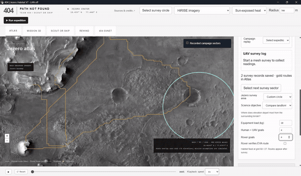
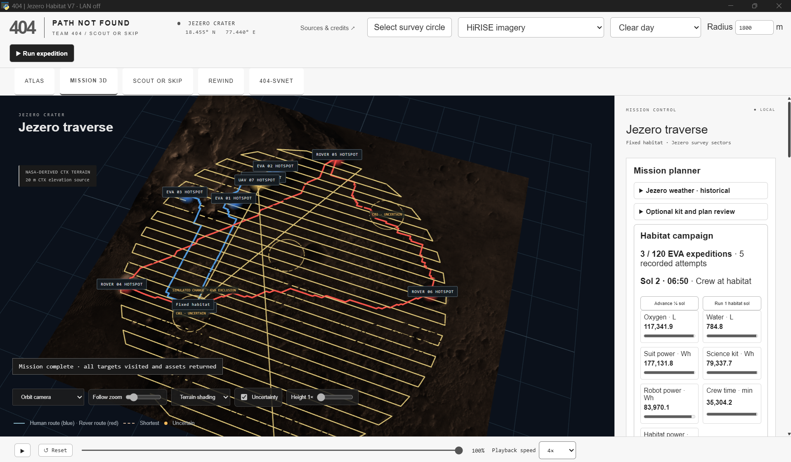
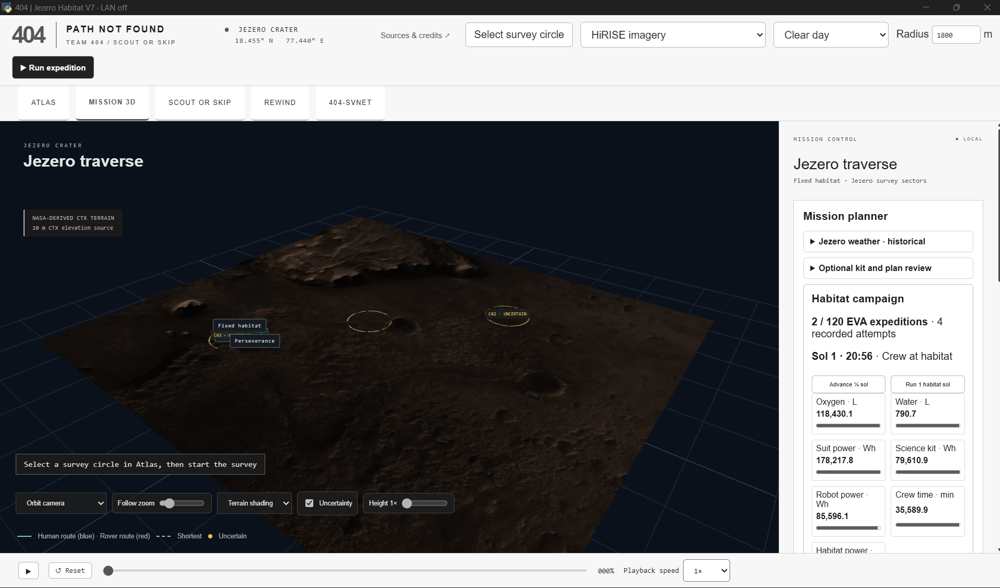
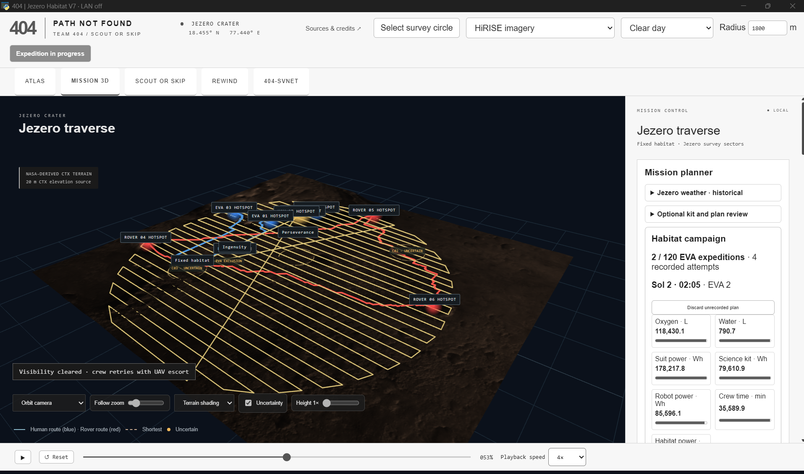
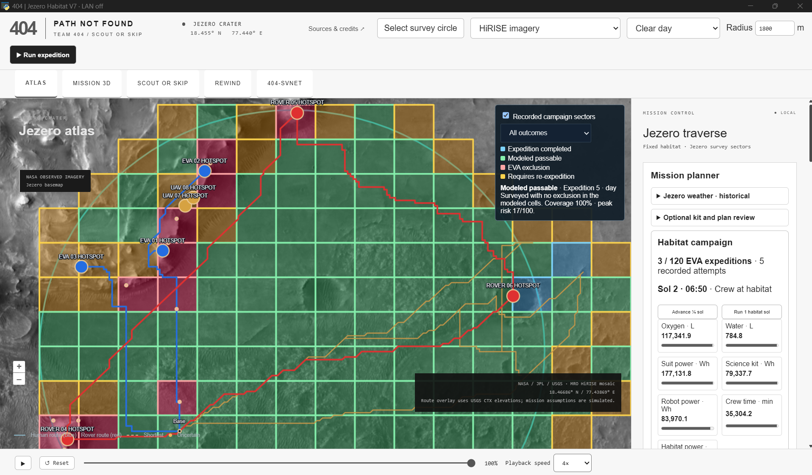
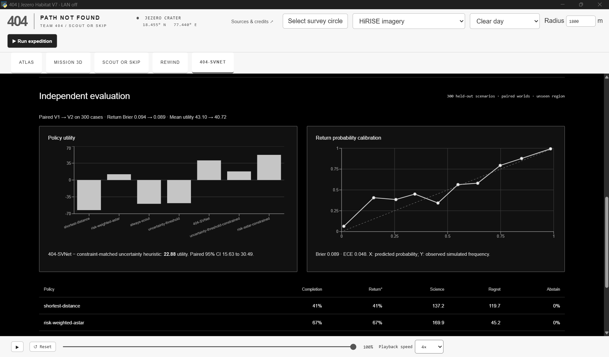
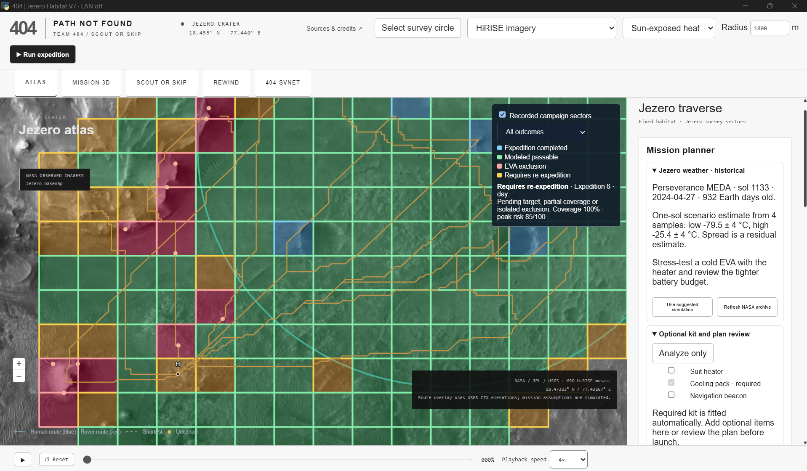

# 404: PATH NOT FOUND

<!-- TEAM404 VIDEO DEMO START -->
## Watch the V7 mission demonstration

Explore the complete Jezero expedition: NASA-derived terrain, UAV scouting, rover confirmation, astronaut EVA, weather planning, mission replay and accumulated habitat campaign records.

[](docs/media/404_PATH_NOT_FOUND_V7_Demo.mp4)

**[▶ Watch or download the full V7 demonstration (MP4)](docs/media/404_PATH_NOT_FOUND_V7_Demo.mp4)** · 1 min 21 sec

*The animated preview plays directly in this README. Click it to open the full video with audio. GitHub only supports a native inline MP4 player for videos uploaded through GitHub's web editor as an attachment; see the included instructions.*
<!-- TEAM404 VIDEO DEMO END -->


**Team 404 | Jezero Crater | NASA Space Apps Challenge 2026**  
*A Marswalk and habitat-expedition planning simulator with terrain-aware scouting, crew/rover routing, campaign resources and decision evaluation.*



## At a glance

The project brings a NASA/USGS Jezero map, terrain mesh, research decision models and a **persistent habitat campaign** into one interactive application. A simulated UAV surveys first; the planner then allocates stops and computes constrained astronaut and rover paths with return checks. Users can inspect the routes, weather-derived scenario suggestions, available supplies, mission replay and sector-by-sector outcomes.

**Five main views:** **Atlas** (imagery, route overlays, recorded sectors), **Mission 3D** (mission playback and habitat inventory), **Scout or Skip** (decision exploration), **Rewind** (saved research runs), and **404-SVNet** (model evaluation).

## Installation — choose your version

| Option | What you get | Requirements | Start here |
| --- | --- | --- | --- |
| **Windows desktop (recommended)** | Native app window; bundled frontend; no Node.js needed | Windows, 64-bit Python **3.11 or 3.12**, Edge WebView2 | [`README_DESKTOP.md`](README_DESKTOP.md) · [`docs/INSTALLATION.md`](docs/INSTALLATION.md) |
| **Browser/development** | Editable React/TypeScript frontend and Python FastAPI server | Python **3.11 or 3.12**, Node.js **22.12+** (or 24) | [`docs/INSTALLATION.md`](docs/INSTALLATION.md#option-b-browser-and-developer-mode) |

**Fastest start on Windows:** extract the ZIP, run `setup_desktop.bat` once, then run `start_desktop.bat`. The app opens in its own window. Initial dependency installation needs internet; bundled terrain and maps work locally afterwards. The **NASA archive refresh** button is optional and does need network access.

For full command-by-command setup, Linux/macOS developer notes, troubleshooting, tests and deployment details see **[Installation and verification](docs/INSTALLATION.md)**.

## Screenshots — V7 desktop build

The screenshots below are taken from the current V7 interface, including persistent habitat accounting, campaign-sector outcomes and the historical Jezero weather panel.

| Initial Jezero 3D scene | UAV sweep and mission paths |
| :---: | :---: |
|  |  |
| **Recorded sector outcomes** | **Atlas after an expedition** |
|  |  |
| **Independent 404-SVNet evaluation** | **Historical weather and equipment analysis** |
|  |  |

The **completed mission** screenshot appears at the top of this README. All seven original-size images are indexed in [Screenshot guide](docs/SCREENSHOTS.md).

## How to run an expedition

1. In **Atlas**, inspect the Jezero area and select a survey circle; use the **Radius** field to adjust coverage. Choose imagery and a weather scenario.
2. Click **Run expedition** to generate a fresh plan. Use **Optional kit and plan review** for preflight analysis and equipment; inspect any holds or limitations.
3. Open **Mission 3D** and play the route. The simulated UAV surveys before crew traversal; blue routes represent astronaut EVA, red routes represent Perseverance, and the gold lines show the scouting sweep.
4. Review **Habitat campaign** for supplies, attempted expeditions and simulated clock. Continue the campaign using additional sectors; completed excursions are recorded into a local SQLite ledger.
5. Inspect **Atlas** again to see recorded sector outcomes. In **404-SVNet**, review the separate independent policy and calibration evaluation.

**Campaign behavior:** expeditions may include multiple EVA segments and a rover traverse; the simulator checks per-sortie return/resource constraints and total campaign stock. Replays do not charge the campaign inventory a second time. The UI shows a 120-expedition target rather than promising 120 successful outings.

## Why a tapered UAV scout region?

A cone-like approach corridor starts narrow at the fixed habitat and expands toward the selected survey circle. It prioritizes the approach/return corridor instead of sweeping the full width immediately. When the initial footprint does not reveal enough reachable cells, the algorithm expands to a constant-width corridor and then a wider search. **Saving time or battery relative to wide-first survey is a design motivation, not an experimentally established performance result.**

## Terrain, weather, and model evidence

- **Observed/derived:** cached Mars Trek HiRISE/CTX imagery, a USGS CTX elevation crop, local slope/relief and imagery-texture proxies, plus relevant MOLA/HRSC and THEMIS context.
- **Simulated:** survey observations, route hazards and closures, crew/rover/UAV missions, resource consumption, equipment scenarios and 404-SVNet outcome labels.
- **Weather:** optional online refresh of historical Perseverance MEDA readings and offline, one-sol scenario extrapolation. A historical rover temperature estimate is **not** a live crater forecast. Odyssey/MRO layers are context; this release does not automatically subscribe to orbital telemetry.
- **404-SVNet V2:** paired evaluation across 300 held-out synthetic scenarios. Return Brier score was **0.0936 (V1) vs 0.0887 (V2)**; mean simulated utility **43.10 (V1) vs 40.72 (V2)**. V2 improved squared probability error but did not improve mean utility in that paired test. See [V2 evaluation](docs/SVNET_V2_EVALUATION.md).

This is a **research demonstration**, not an astronaut-certified navigation, weather forecasting or life-support system. Source credits and distinctions between real terrain data and simulated outcomes are in [Data sources](docs/DATA_SOURCES.md).

## Project structure

```text
app/                  Python FastAPI backend, planning, environment, weather and model inference
apps/web/             React / TypeScript web app and bundled production build (dist/)
data/                 Terrain imagery, samples and saved research datasets
models/               Bundled SVNet and mission-Q&A artifacts
research/             Dataset generation, comparison and evaluation scripts
scripts/              Setup, development, acquisition, rendering and training utilities
docs/screenshots/     Seven V7 interface captures used in this README
docs/                 Methods, references, validation notes, installation and screenshots
README_DESKTOP.md     Native desktop workflow, inventory and crew-terminal details
setup_desktop.bat      One-time desktop Python environment setup
start_desktop.bat      Desktop launcher
CREATE_AND_PUBLISH_GITHUB.cmd / .ps1   GitHub repository creation + publish helper
```

The `apps/web/dist/` directory is bundled in this release for desktop use. If developing the frontend, use Node.js and rebuild with `npm run build`.

## Documentation

**[Install and troubleshoot](docs/INSTALLATION.md)** · **[V7 verification](docs/VERIFICATION_V7.md)** · **[Screenshot guide](docs/SCREENSHOTS.md)** · **[Desktop campaign](README_DESKTOP.md)** · **[Data and attribution](docs/DATA_SOURCES.md)** · **[SVNet evaluation](docs/SVNET_V2_EVALUATION.md)** · **[GitHub publication](GITHUB_PUBLISHING.md)** · **[Documentation index](docs/README.md)**

## License and attribution

Original project code: see [LICENSE](LICENSE). Included NASA/USGS imagery and third-party models retain their respective source terms; see [NOTICE](NOTICE) and the source register. NASA does not sponsor or endorse this project.

## NASA Space Apps 2026 presentation

[View the seven-slide Team 404 presentation](404_PATH_NOT_FOUND_NASASPACEAPPS.pdf)
