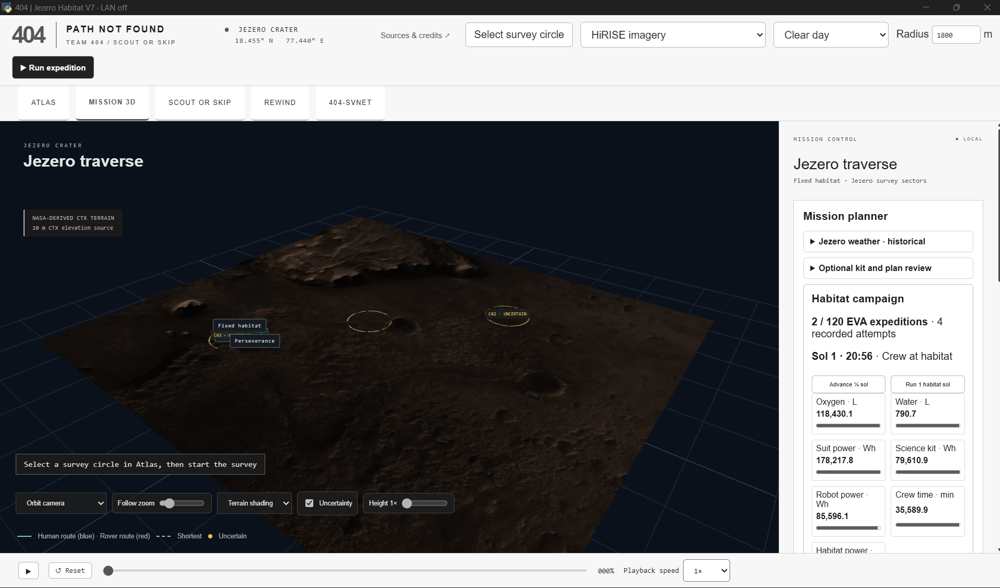
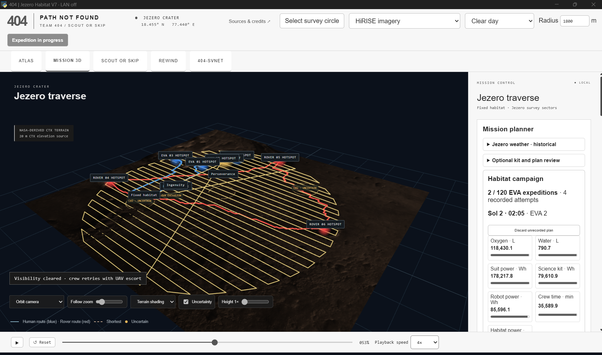
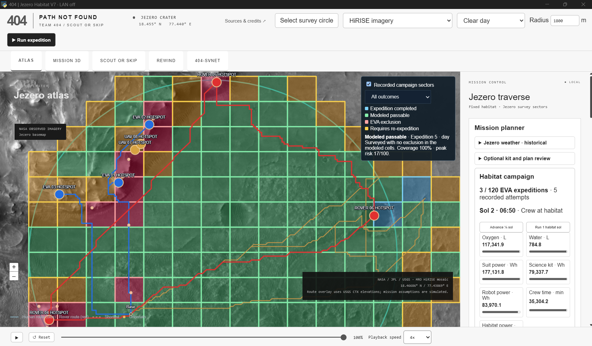
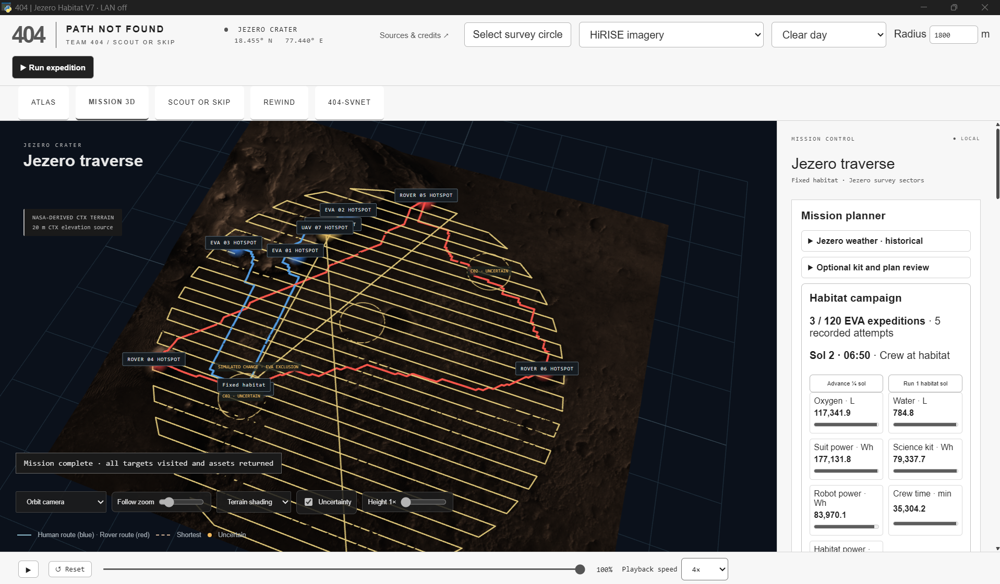
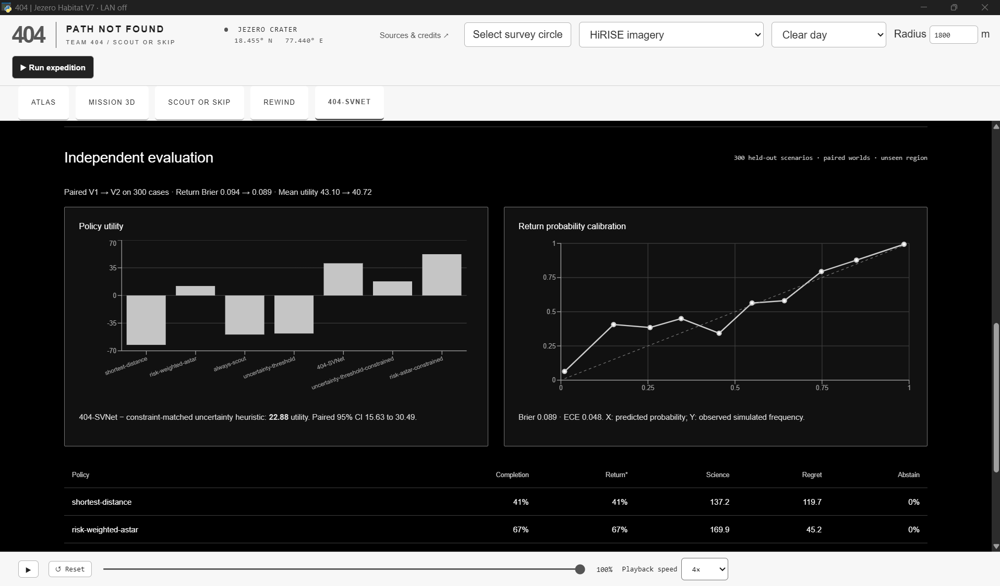
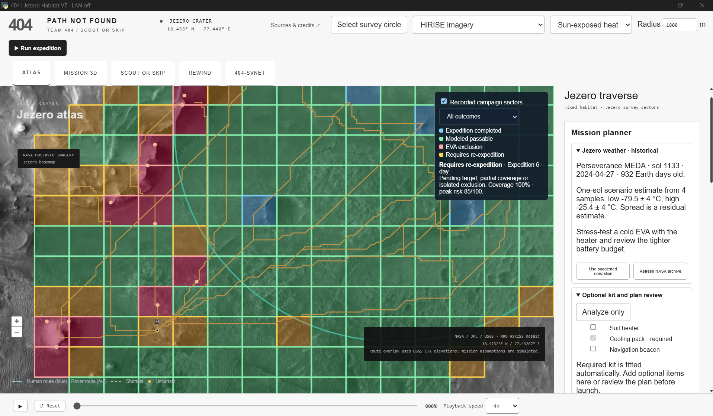

# V7 Screenshot guide

These seven screenshots were supplied from the Team 404 **Jezero Habitat V7** desktop application. They are documentation captures, not background textures or replacements for NASA imagery datasets.

| Capture | File | Scene |
| --- | --- | --- |
| 01 | [`v7-01-mission-launch.png`](screenshots/v7-01-mission-launch.png) | Mission 3D before dispatch, fixed habitat, Jezero CTX mesh and expedition launcher |
| 02 | [`v7-02-scouting-and-routes.png`](screenshots/v7-02-scouting-and-routes.png) | Gold UAV coverage sweep, blue crew route, red rover route and mission planner |
| 03 | [`v7-03-atlas-recorded-sectors.png`](screenshots/v7-03-atlas-recorded-sectors.png) | Atlas with accumulated expedition outcomes and sector-color legend |
| 04 | [`v7-04-atlas-expedition-record.png`](screenshots/v7-04-atlas-expedition-record.png) | Another recorded campaign Atlas view after route playback |
| 05 | [`v7-05-mission-completed.png`](screenshots/v7-05-mission-completed.png) | Completed mission, goals visited and assets returned to base in simulation |
| 06 | [`v7-06-svnet-independent-evaluation.png`](screenshots/v7-06-svnet-independent-evaluation.png) | 404-SVNet independent synthetic evaluation, utility chart, return calibration and policy table |
| 07 | [`v7-07-weather-and-equipment.png`](screenshots/v7-07-weather-and-equipment.png) | Historical Perseverance MEDA temperatures, one-sol estimate and kit preflight |

## Large views

### 1. Initial survey / mission setup

### 2. UAV sweep and asset routes

### 3. Recorded campaign sectors

### 4. Atlas campaign result

### 5. Completed 3D simulation

### 6. Model evaluation

### 7. Weather and equipment

The screenshot weather panel shows *historical* NASA rover observations and a simulator scenario estimate. It does not show live NASA satellite telemetry or a validated meteorological forecast. 
